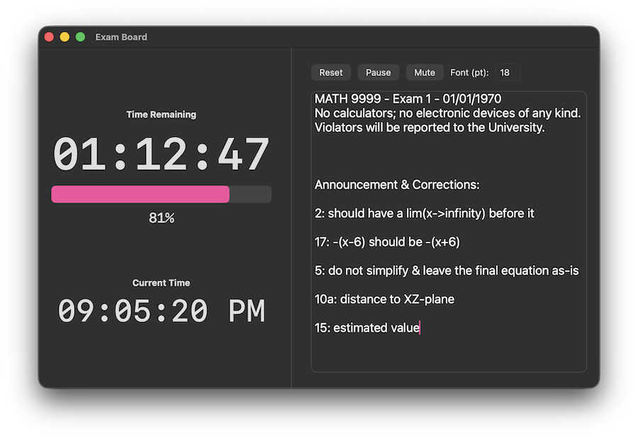

# Exam Board

A simple Mac application that functions as a countdown timer with an editable textpad, which instructors can project onto a screen during an exam.

Download the latest release here.

## Features

- Countdown timer

- Real-time clock (using device time)

- Textpad with adjustable font for making exam announcements

- Voice announcement of time remaining (exam begins, 1 hour left, 30/15/5/2/1 minute left, stop writing)

## Technical Details

**Mac OS Compatibility:** 10.15 (Catalina) or newer.

**Frameworks Used:** SwiftUI

**License:** [GNU General Public License v3.0](LICENSE)